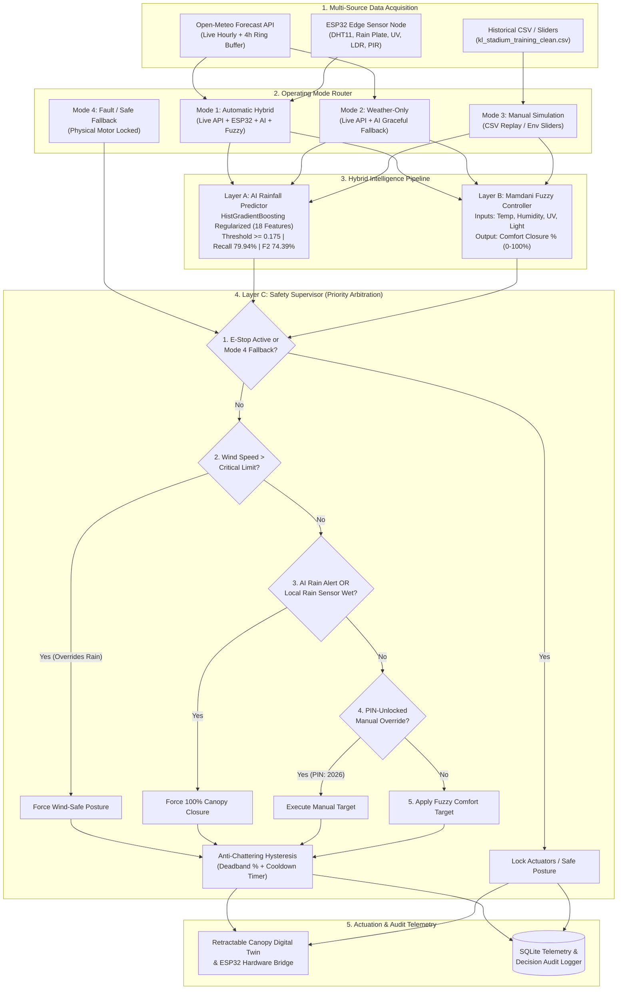
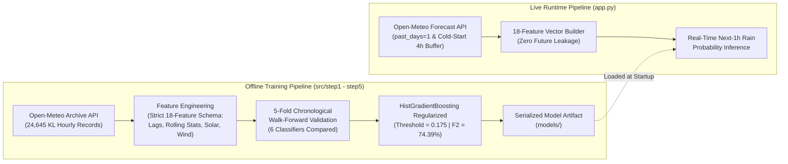

# 🏟️ Intelligent Stadium Microclimate & Canopy Control System

A hybrid **Machine Learning + Mamdani Fuzzy Logic + Safety Supervisor + IoT-Ready** system for autonomous retractable stadium canopy control in Kuala Lumpur, Malaysia (`3.1412°N, 101.6865°E`).

---

## Project Implementation Status

- **Completed Offline ML Pipeline (`src/step1` – `src/step5`, `models/`, `reports/`):**
  - Cleaned **24,645 hourly** Kuala Lumpur historical weather records (`data/kl_stadium_training_clean.csv`).
  - Evaluated **6 classifiers** using **5-fold chronological walk-forward validation**.
  - Selected **HistGradientBoosting Regularized** (`threshold = 0.175`, **Recall = `79.94%`**, **F2 = `74.39%`**).
- **Software Operational System (`src/weather_service.py`, `src/ai_predictor.py`, `src/fuzzy_controller.py`, `src/safety_supervisor.py`, `src/esp32_bridge.py`, `src/telemetry_logger.py`, `app.py`):**
  - Live **Open-Meteo Forecast API** integration with cold-start **4-hour ring buffer** (`past_days=1`) and zero future leakage.
  - **Mamdani Fuzzy Inference System** for thermal/UV/light comfort optimization (`0–100%` closure).
  - Independent **Safety Supervisor** enforcing structural wind overrides, anti-chattering hysteresis (deadband + cooldown), PIN-locked manual overrides, and hardware fault fallback.
  - Interactive **5-page Streamlit dashboard** with SQLite audit persistence and offline CSV replay.

---

## System Architecture & Three-Layer Decision Flowchart

The runtime controller enforces a strict **Three-Layer Arbitration Hierarchy** so structural wind safety always overrides rainfall protection, and rainfall protection always overrides thermal comfort:



---

## Offline ML Training vs. Live Inference Pipeline



---

## Operating Modes & Dashboard Structure

### Four Operating Modes (Initializes in `Standby`)
| Mode | Name | Data Sources | Motor Dispatch | Purpose |
| :--- | :--- | :--- | :--- | :--- |
| **Mode 1** | **Automatic Hybrid** | Live Open-Meteo Forecast API + ESP32 Local Sensors | Enabled (Bench / HW) | Full hybrid operation combining cloud forecast and local sensors. |
| **Mode 2** | **Weather-Only** | Live Open-Meteo Forecast API + AI Predictor | Enabled (Bench / HW) | Automatic fallback when ESP32 sensor nodes are disconnected. |
| **Mode 3** | **Manual Simulation** | Offline KL Historical CSV Replay or Manual Sliders | Virtual Digital Twin | Software-only testing and demo of rainstorms / high-wind overrides. |
| **Mode 4** | **Fault / Safe Fallback** | Telemetry Monitoring Only | **Locked / Blocked** | Safe maintenance/emergency state holding roof in protective posture. |

### 5-Page Dashboard Layout
1. **Overview**: Mode selector cards, Kuala Lumpur live microclimate card, 6-tile microclimate highlight grid (`Wind`, `Humidity`, `UV`, `Cloud Cover`, `Solar Radiation`, `Fuzzy Comfort`), and subsystem status summary.
2. **Sensors & Weather**: 5-step hourly microclimate trajectory strip, Open-Meteo cloud telemetry table, and ESP32 software hardware bench (simulates online status and 3-strike `DHT11` sensor faults).
3. **AI & Fuzzy Logic**: Real-time next-1h rainfall probability (`>= 0.1 mm` target), strict 18-feature inference vector table, and active Mamdani IF–THEN rules with firing strengths.
4. **Canopy Control**: Interactive SVG retractable canopy cross-section schematic, actuator position integrity (`Requested` vs. `Confirmed` vs. `Virtual`), safety threshold settings, and PIN-locked manual override (`Default Demo PIN: 2026`).
5. **Analytics & Logs**: Persistent SQLite decision audit log with CSV export, plus offline 5-fold walk-forward validation metrics and figures (`reports/figures/`).

---

## Project Structure

```text
smart-stadium-canopy-ai/
├── .streamlit/
│   └── config.toml                        # Dashboard light theme configuration
├── app.py                                 # 5-page Streamlit Command Center UI
├── src/
│   ├── step1_* ... step5_*                # Offline data cleaning, walk-forward CV & model export
│   ├── config.py                          # Global thresholds, paths & mode constants
│   ├── weather_service.py                 # Open-Meteo Forecast API & CSV replay service
│   ├── ai_predictor.py                    # HistGBM rainfall inference wrapper (18 features)
│   ├── fuzzy_controller.py                # Mamdani fuzzy thermal comfort controller
│   ├── safety_supervisor.py               # Layer C priority interlocks, deadband & PIN auth
│   ├── esp32_bridge.py                    # Hardware abstraction & virtual bench loopback
│   └── telemetry_logger.py                # SQLite persistent decision & sensor logger
├── data/
│   └── kl_stadium_training_clean.csv      # 24,645 cleaned hourly KL weather records
├── models/                                # Exported HistGradientBoosting model & metadata
├── reports/figures/                       # Walk-forward validation & EDA plots
└── requirements.txt                       # Python dependencies
```

---

## How to Run (Windows / VS Code / `stadium_env`)

```bash
conda activate stadium_env
streamlit run app.py
```

*(If running in standard Windows CMD where `conda` is not on `PATH`, run directly with your Conda environment Python executable:)*
```cmd
"%USERPROFILE%\anaconda3\envs\stadium_env\python.exe" -m streamlit run app.py
```

### Quick Demo Walkthrough
- **Simulate Rainstorm Response:** Select **Mode 3 (Manual Simulation)** in **Overview** and click **Rain Event** to jump to an oncoming Kuala Lumpur rainstorm and watch the AI trigger `100%` canopy closure.
- **Test Structural Wind Override:** Switch Mode 3 to **Manual Environmental Sliders**, enable **Local Rain**, and raise **Wind Speed** above `35 km/h` to verify that structural wind protection overrides rain closure.
- **Test PIN Manual Override:** Navigate to **Canopy Control** and enter Operator PIN **`2026`** to unlock manual motor commands.