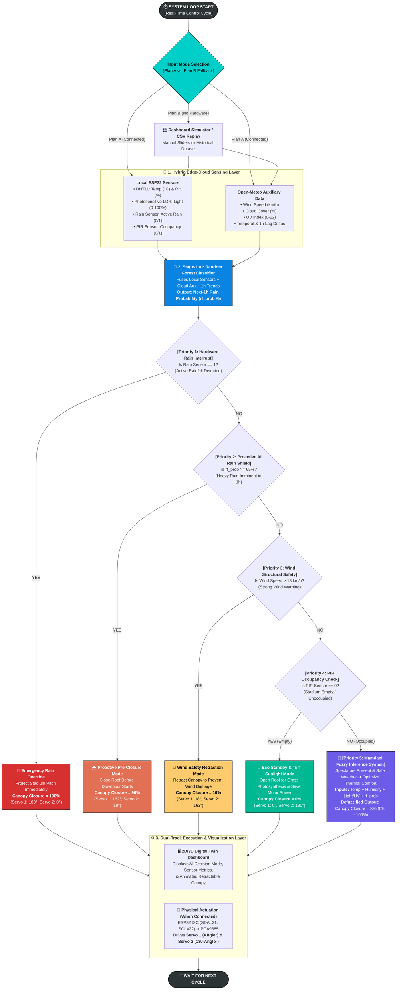

# 🏟️ Intelligent Stadium Microclimate & Canopy Control System

An IoT and AI-driven smart stadium prototype combining **ESP32 local sensors**, **Open-Meteo cloud auxiliary data**, a **Random Forest precipitation classifier**, and a **Mamdani Fuzzy Inference System (FIS)** for autonomous retractable canopy control.

## 🧠 System Architecture & 5-Level Priority Flowchart

